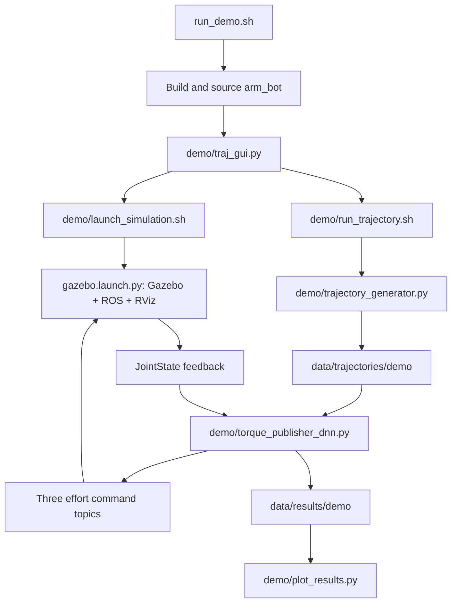

# Final architecture

## Runtime layout

The project has one ROS package, `arm_bot`, with four source groups:

- `scripts/demo/`: the final presentation GUI and its trajectory/inference/plotting workflow.
- `scripts/controllers/`: the latest comparison DNN, CTC, and trajectory PID controllers.
- `scripts/shared/`: path resolution, the triggered joint-state logger, symbolic inverse dynamics, and RViz line drawing.
- `scripts/analysis/`: DNN and CTC log analysis.

User-facing run commands are documented in the single [final run guide](../RUN_GUIDE.md).

## Final presentation flow



The GUI starts motion generation after all three effort controllers report activation. The trajectory wrapper generates, executes the newest generated CSV, and plots the result. Its batch/multiple-path options do not simulate every generated CSV automatically.

## Controller comparison flow

`arm_bot/all.sh` builds and launches the same simulator, then runs the comparison DNN, CTC, and PID controllers for each selected CSV, in that order. Their stabilization, timing, gains, and control calculations remain those of the retained final implementations. Simulation resets retain the original best-effort calls.

The demo DNN performs online inference. The comparison DNN precomputes desired-state feedforward by default and also supports actual-state inference. They are retained as distinct final workflows.

### Analytical computed torque control

```text
e = q_des - q_actual
v_feedback = Kp*e + Kd*(qd_des - qd_actual) + Ki*integral(e)
tau = D(q)*(qdd_des + v_feedback) + C(q, qd) + G(q)
```

`C` is the Coriolis/centrifugal torque vector. The controller's dynamics-frame option selects desired or sensed state for the model. `shared/inverse_dynamics_model.py` constructs the inertia matrix, gravity vector, and Coriolis vector symbolically and lambdifies them with SymPy. The CoG-based model and its calculations are unchanged.

### Learned feedforward

```text
tau_dnn = tau_delan(q, qd, qdd) + tau_gru(history)
tau_command = tau_dnn + feedback
```

DeLaN learns a structured Lagrangian with a positive mass-matrix construction and potential energy. The GRU uses 128-step windows of 12 scaled features: `q(3), qd(3), qdd(3), tau_delan(3)`. It has four recurrent layers, hidden size 64, and three output torques. Before its history is full, the publisher uses DeLaN alone. Feedback filtering/limiting remains specific to each retained publisher.

Default checkpoints and scaler are in `models/`. Their bytes were preserved. `tools/infer_torques.py`, formerly the latest standalone `inf7.py`, is a separate offline inference workflow with its existing residual clipping and ramp behavior.

### PID

`controllers/pid_controller_trajectory.py` supports CSV reference motion and generated minimum-jerk motion. It retains PID torque feedback, optional acceleration feedforward, torque bias, anti-windup, and torque clipping.

## Robot and ROS interfaces

The controlled robot has three active effort joints. The expanded URDF has six links and five joints, including fixed joints. Geometry and inertial definitions are in `description/robot_core.xacro`; `description/ros2_control.xacro` selects the Gazebo control plugin. The controller-manager update rate in `config/my_controllers.yaml` remains **100 Hz**. Initial joint positions are `[0°, 45°, 135°]`.

Only meshes referenced by the final robot remain in the ROS package (`puma_link1.stl` through `puma_link4.stl`). Other mesh assets were preserved under `data/retained_assets/`.

| Interface | Role |
| --- | --- |
| `/joint_states` | Sensed positions, velocities, and effort |
| `/joint_1_controller/commands` | Joint 1 effort command |
| `/joint_2_controller/commands` | Joint 2 effort command |
| `/joint_3_controller/commands` | Joint 3 effort command |
| `/clock` | Bridged simulation clock |
| `/recording_state` | Enables/disables trajectory drawing |
| `/logger/start`, `/logger/stop` | Triggered state-logging services |

The sole launch file, `gazebo.launch.py`, starts Gazebo, the clock bridge, robot state publisher, robot spawning, the joint-state broadcaster, effort controllers, RViz, and line drawing.

## Data and outputs

Trajectory CSVs generally store signal labels in the first column and timesteps across columns: `t`, `dp1..dp3`, `dv1..dv3`, `da1..da3`. CLI endpoint/waypoint angles use degrees; trajectory signals use radians and their time derivatives. Detailed controller logs use one header row and one row per timestep.

`shared/project_paths.py` discovers the checkout and centralizes `data/` and `models/` paths. Source/symlink installs resolve automatically; copied installs need `PUMA_PROJECT_ROOT`. Data and results are outside the ROS installation so rebuilding does not copy datasets into the package.

All 4,106 protected artifacts are recorded in [the preservation manifest](../data/MANIFEST.csv). Original local-only data remains local-only; original tracked artifacts remain tracked after relocation. Research training source, MATLAB references, and notebooks are separate under `research/`.
