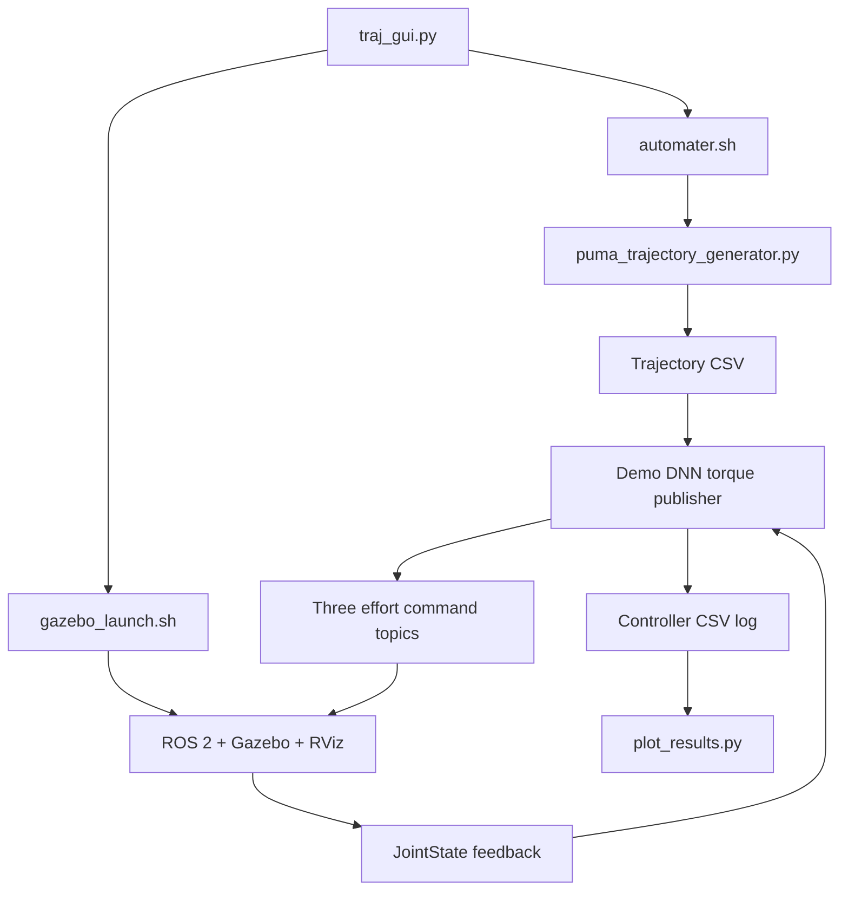

# Architecture and code reading guide

## Scope of the robot model

The simulation exposes effort commands for `joint_1`, `joint_2`, and `joint_3`. The PUMA name refers to the source arm; the controlled system in this repository has three active joints. The expanded main URDF contains six links and five joints, including fixed joints.

`arm_bot/src/description/robot_core.xacro` defines geometry, joint limits, inertial properties, and mesh references. `ros2_control.xacro` connects the three effort interfaces to `gz_ros2_control`. `config/my_controllers.yaml` sets a 100 Hz controller-manager update rate and uses `forward_command_controller/ForwardCommandController` for each joint. The initial joint state is `[0°, 45°, 135°]`.

## Execution flow



The GUI monitors simulation output until all three joint controllers report activation. `automater.sh` generates trajectories, selects the newest trajectory CSV, executes the demo publisher with an explicit log path, and invokes the plotter. In batch or multiple-path generation, the wrapper executes the newest generated file; it does not automatically simulate every generated trajectory.

The comparison runner `all.sh` independently builds and launches the same simulation, then runs the main DNN, CTC, and PID implementations for each selected CSV. Each controller owns its stabilization and tracking phases. The runner resets the simulator between runs.

## Main controllers

| Controller | Source | Control behavior |
| --- | --- | --- |
| Demo DNN | `arm_bot/src/scripts/Demo_controller/torque_publisher_dnn.py` | Online DeLaN + GRU inference with configurable feedback; used by the GUI |
| Comparison DNN | `arm_bot/src/scripts/torque_publisher_dnn.py` | Precomputes desired-state feedforward by default; also supports actual-state inference, feedback smoothing, torque rate limiting, and model ablations |
| Computed torque | `arm_bot/src/scripts/torque_publisher_ctc.py` | Analytical inverse dynamics with feedback in acceleration space |
| Trajectory PID | `arm_bot/src/scripts/controller/pid_controller/pid_controller_trajectory.py` | PID torque feedback with optional acceleration feedforward and torque bias |
| Earlier modular DNN | `arm_bot/src/scripts/controller/dnn_controller/` | Separate controller, predictor, and minimum-jerk path planner |

The demo and comparison DNN implementations are distinct experiments. They retain their own defaults and numerical behavior.

For CTC, the core law is:

```text
e = q_des - q_actual
v_feedback = Kp*e + Kd*(qd_des - qd_actual) + Ki*integral(e)
tau = D(q)*(qdd_des + v_feedback) + C(q, qd) + G(q)
```

Here `C` is the Coriolis/centrifugal torque vector. The selected dynamics frame determines whether `q` and `qd` come from desired or sensed states. Torque clipping and anti-windup remain in the controller.

`inverse_dynamics_model.py` constructs the symbolic model and lambdifies the inertia matrix, gravity vector, and Coriolis vector using SymPy. It follows the CoG-based symbolic model in `inv_dyn.py`; agreement with that model alone does not establish agreement with every simulator variant.

The learned model returns:

```text
tau_dnn = tau_delan(q, qd, qdd) + tau_gru(history)
tau_command = tau_dnn + feedback
```

The DeLaN model uses a structured Lagrangian, with a positive mass-matrix construction and learned potential energy. The GRU consumes 128-step windows of 12 scaled features: `q(3), qd(3), qdd(3), tau_delan(3)`. Its architecture has four recurrent layers, hidden size 64, and three output torques. Before a full history window is available, the publisher uses DeLaN alone. Additional feedback and limiting behavior differs between demo and comparison implementations.

## ROS interfaces

| Interface | Role |
| --- | --- |
| `/joint_states` | Sensed position, velocity, and effort |
| `/joint_1_controller/commands` | Joint 1 effort (`Float64MultiArray`) |
| `/joint_2_controller/commands` | Joint 2 effort |
| `/joint_3_controller/commands` | Joint 3 effort |
| `/clock` | Bridged simulator clock |
| `/recording_state` | Enables/disables trajectory drawing |
| `/logger/start`, `/logger/stop` | Triggered logger services |

The launch file starts the simulator and clock bridge, publishes the Xacro robot description, spawns the robot, activates the joint-state broadcaster and effort controllers, and starts RViz and the trajectory line drawer. The publishers also create path markers for expected and actual motion.

## CSV and model contracts

Trajectory files commonly store **signals as rows**, with the signal label in the first cell:

```text
t,0.000,0.010,...
dp1,...
dp2,...
dp3,...
dv1,...
dv2,...
dv3,...
da1,...
da2,...
da3,...
```

Times are seconds; joint positions, velocities, and accelerations use radians, radians/second, and radians/second². CLI endpoint and waypoint arguments generally use degrees. Some historical CSVs include torque rows or additional dynamics terms; do not assume every CSV shares one layout. Controller logs instead have a header row and one row per timestep.

Default learned-model assets are `DNN_test/fyp_jax_delan_50.jax`, `best_GRUResidual.pt`, and `feature_scaler.pkl`. They form a matching inference set. Alternative `_o1`, `_o2`, and `_o3` checkpoints are retained as research artifacts and are not substituted automatically.

## Earlier data-generation workflows

Root-level trajectory generators produce kinematics. `inv_dyn.py`, `inv_dyn1.py`, and `inverse_dynamics_fast.py` provide alternative analytical dataset generation; `batch_processor.py` connects generation and processing. They remain separate implementations.

`id_pipeline/` plays reference motion with PD and gravity compensation, records commanded torque and measured state, and applies filtering/differentiation to build training CSVs. Its reference configuration targets 1000 Hz. `pipeline.yaml` is a reference sheet; the scripts consume CLI flags and in-code settings, not a YAML configuration argument.

`DNN_test/DeLaN/` contains dataset packing and DeLaN/black-box training code. `DNN_test/inf*.py` are successive inference experiments. A complete GRU training procedure and deterministic training provenance are not established by the tracked source alone; checkpoints remain available for inference.
