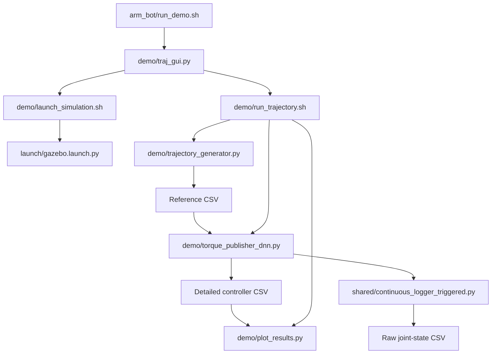

# Code reference: what each file does

This guide explains every retained code file in this repository: **31 Python files, eight shell scripts, three MATLAB scripts, and eight notebooks**. It also explains the build files, robot description, simulator settings, and dependency files that support them. Paths below are relative to the repository root; each file name links to its source.

Use the [run guide](../RUN_GUIDE.md) for setup and commands, [architecture](ARCHITECTURE.md) for the system overview, and this reference when reading or modifying the implementation. Datasets, checkpoints, meshes, and generated results are assets rather than source code; their locations are described in the [data notes](../data/README.md) and [model notes](../models/README.md).

## Contents

1. [How the files work together](#1-how-the-files-work-together)
2. [Top-level launchers and shell helpers](#2-top-level-launchers-and-shell-helpers)
3. [Presentation GUI and trajectory pipeline](#3-presentation-gui-and-trajectory-pipeline)
4. [Comparison controllers](#4-comparison-controllers)
5. [Shared Python modules](#5-shared-python-modules)
6. [Simulation, robot description, and build configuration](#6-simulation-robot-description-and-build-configuration)
7. [Result analysis](#7-result-analysis)
8. [Standalone tools](#8-standalone-tools)
9. [Research Python and MATLAB scripts](#9-research-python-and-matlab-scripts)
10. [Research notebooks](#10-research-notebooks)
11. [Regression tests](#11-regression-tests)
12. [Dependencies and repository support files](#12-dependencies-and-repository-support-files)

## 1. How the files work together

### Presentation flow



The GUI launches the simulator, waits for the three effort controllers to activate, and then starts the generation/execution wrapper. The default presentation uses PID feedback with DeLaN and a GRU residual. Algorithm selection is implemented in the controller command-line arguments; the GUI's three controller indicators show joint-controller readiness.

### Comparison flow

`arm_bot/all.sh` starts the same simulation and runs the files under `controllers/` in the order **DNN → CTC → PID** for each selected reference. `scripts/terminal_job.sh` reports each child process's status to the batch runner. The DNN and CTC publishers manage the shared raw logger; the standalone PID controller writes its own log and plots.

The Python controllers read `/joint_states` and publish one effort command per joint to `/joint_1_controller/commands`, `/joint_2_controller/commands`, and `/joint_3_controller/commands`. The ROS forward-command controllers pass these torques to the simulated arm. Their YAML configuration does not choose between PID, CTC, and DNN.

### Data and notation used in the source

| Name | Meaning |
| --- | --- |
| `q`, `qd`, `qdd` | Three joint positions, velocities, and accelerations: radians, rad/s, and rad/s² |
| `q_des`, `q_ref`, `dp1..3` | Desired joint positions; `dv1..3` and `da1..3` are desired velocity and acceleration |
| `tau`, `τ` | Three joint torques in Nm |
| `D`, `C`, `G` | Inertia matrix, Coriolis/centripetal torque vector, and gravity torque vector |
| `e_pos`, `e_vel` | Desired state minus measured state |
| `tau_delan` | Torque from the learned Lagrangian model |
| `tau_dnn` | DeLaN plus the GRU residual, or DeLaN alone before the GRU history is full |
| `tau_fb`, `tau_total` | Feedback contribution and final commanded torque |

CLI joint targets are generally entered in **degrees** and converted to radians. Reference CSVs usually have **one signal per row**, starting with its label: `t`, `dp1..3`, `dv1..3`, `da1..3`. Controller and raw logs have **one time sample per row**, with a header. Extra training/inference rows depend on the consumer; the research packer has its own positional contract described below.

For an advisor reading the implementation, start with the simulation launch and robot description, then the generator, the three comparison controllers, the shared analytical dynamics, and the analysis scripts. Read the presentation GUI afterward to see how the demonstration is orchestrated.

## 2. Top-level launchers and shell helpers

### [`arm_bot/run_demo.sh`](../arm_bot/run_demo.sh)

**Role:** user-facing entry point for the final presentation.

It cleans inherited desktop-library paths, selects the project Python interpreter, checks required commands, and runs `tools/check_runtime.py` before opening the GUI. It builds only the `arm_bot` package with `colcon build --symlink-install`, sources the resulting workspace, and replaces its process with `demo/traj_gui.py`. `--no-build` reuses an existing installation; `--help` prints usage. Relative project/data/model/log overrides are resolved before changing into the workspace. It starts simulation through the GUI, rather than directly in this file.

### [`arm_bot/all.sh`](../arm_bot/all.sh)

**Role:** user-facing batch comparison runner.

It selects the original path-ID list or IDs supplied on the command line, locates the corresponding `path_NNN_joint_states.csv` inputs, and checks the model files, commands, and Python runtime. `--csv-dir` changes the input directory; `--check` performs preflight without building or launching simulation. A normal run builds/sources the workspace, opens GNOME Terminal jobs, and executes the comparison DNN, CTC, and PID controllers in sequence. It attempts a simulator reset and marker cleanup between runs and uses status files to detect controller failures and timeouts. Cleanup targets its recorded process groups. Console output goes to `data/results/console/` by default; detailed controller CSVs have their own output locations.

### [`arm_bot/setup_runtime.sh`](../arm_bot/setup_runtime.sh)

**Role:** create or repair the compatible Python overlay.

It uses `/usr/bin/python3`, or `PUMA_BASE_PYTHON`, to create `.venv-ros/` with access to system-site packages. It installs the NumPy/scikit-learn overrides in `requirements/ros-overlay.txt`, sources ROS Humble if needed, and runs the runtime check. This script reuses the installed ROS and inference stack; installing OS packages or every inference dependency is covered separately in the run guide. Its persistent output is the ignored project environment.

### [`arm_bot/scripts/desktop_environment.sh`](../arm_bot/scripts/desktop_environment.sh)

**Role:** environment helper sourced by launch scripts.

It removes Snap-specific components from inherited GTK, GIO, Qt, graphics, XDG, and library-search variables while retaining system, ROS, and other custom entries. This prevents host Python/GUI programs from loading incompatible Snap desktop libraries. It unsets a variable when no usable entries remain. It contains no robot-control logic and makes no persistent change to shell configuration files.

### [`arm_bot/scripts/runtime_environment.sh`](../arm_bot/scripts/runtime_environment.sh)

**Role:** keep launched Python processes on the same interpreter.

Its selection order is an explicit `PUMA_PYTHON`, the checkout's `.venv-ros/bin/python3`, then the existing `python3` on `PATH`. It exports the selected executable as `PUMA_PYTHON` and prepends its directory to `PATH`, including for ROS executables with Python shebangs. It deliberately preserves the virtual-environment executable path instead of resolving its symlink. Compatibility is tested by `check_runtime.py`, not by this selector.

### [`arm_bot/scripts/terminal_job.sh`](../arm_bot/scripts/terminal_job.sh)

**Role:** internal child-process wrapper used by `all.sh`.

Inputs are the workspace, status-file path, PID-file path, console-log path, and command with arguments. It sources the workspace and environment helpers, starts the command in a new process group with `setsid`, mirrors output through `tee`, and waits for completion. Its exit trap atomically writes the command status and terminates remaining members of that group. The parent can therefore distinguish success, failure, and interruption even when the command runs in another terminal. Arguments remain separate shell arguments, including paths containing spaces.

## 3. Presentation GUI and trajectory pipeline

### [`arm_bot/src/scripts/demo/traj_gui.py`](../arm_bot/src/scripts/demo/traj_gui.py)

**Role:** PyQt5 interface and presentation process coordinator.

`TrajectoryGUI` builds the joint-target controls, single/double-curve choice, midpoint fields, duration input, readiness checklist, and simulation/trajectory console tabs. `JointSpinBox` and `JointRow` validate displayed degree values. `_build_gen_command()` converts the UI state into arguments for `run_trajectory.sh`.

`SimMonitorThread` reads simulation output and recognizes joint-controller activation. `ProcThread` runs the trajectory wrapper and streams its output. `_on_run()`, `_on_controllers_ready()`, `_on_gen_done()`, and `_apply_state()` manage the UI lifecycle. `graceful_stop()` and the stop/close handlers signal the launched process groups. The GUI uses the fixed initial pose `[0, 45, 135]` degrees and the default PID+DNN presentation workflow; no algorithm-selection widget is implemented. It delegates trajectory math and torque calculation to other files.

### [`arm_bot/src/scripts/demo/launch_simulation.sh`](../arm_bot/src/scripts/demo/launch_simulation.sh)

**Role:** launch the already-built simulation from the GUI.

It derives the workspace location from its own file path, applies the desktop helper, requires and sources `install/setup.bash`, selects the runtime, and executes `ros2 launch arm_bot gazebo.launch.py`. It does not build the package or start a trajectory publisher. A successful workspace build is its prerequisite.

### [`arm_bot/src/scripts/demo/run_trajectory.sh`](../arm_bot/src/scripts/demo/run_trajectory.sh)

**Role:** run the presentation's generate → execute → plot sequence.

It accepts a direct endpoint/optional midpoint or a conditions CSV, chooses an output directory and path ID, and invokes `trajectory_generator.py`. It selects the newest generated trajectory, assigns an incremented demo log name, runs the demo DNN publisher with that reference and log path, and then passes the log to `plot_results.py`. The simulator must already be running. If generation or execution fails, shell error handling stops the sequence before plotting a successful result. When multiple trajectories are generated, this wrapper executes only the newest one; it is not the comparison batch runner. Helper-script override options are available for compatible interfaces.

### [`arm_bot/src/scripts/demo/trajectory_generator.py`](../arm_bot/src/scripts/demo/trajectory_generator.py)

**Role:** generate desired kinematics without ROS or a neural model.

`TrajConfig` stores the timestep, speed/acceleration limits, initial pose, and fixed fourth-joint angle used for kinematics. `min_jerk_profile()` generates a fifth-order rest-to-rest motion. For a waypoint, `compute_junction_velocity()`, `split_time_by_arc()`, `min_jerk_profile_bounded()`, and `generate_two_segment_trajectory()` construct two segments with a bounded junction velocity. The requested duration can be extended to meet the generator's limits; target angles are rounded to integer degrees in the generation path.

`dh_transform()` and `forward_kinematics()` calculate XYZ coordinates from the generated joint positions. `load_conditions_csv()` reads batch specifications; `run_one_trajectory()` generates/saves one path, and `generate_trajectories()` coordinates direct or CSV requests. Outputs under the chosen base directory are joint-angle CSVs, XYZ CSVs, labeled-row reference CSVs, path-history metadata, and `trajectory_tracking.csv`. These are reference states, not measured robot data or training torque labels. Cartesian values use the generator's kinematic frame; controller/RViz drawing code applies its own world-frame transforms.

### [`arm_bot/src/scripts/demo/torque_publisher_dnn.py`](../arm_bot/src/scripts/demo/torque_publisher_dnn.py)

**Role:** online learned inverse-dynamics controller used by the presentation.

`DNNInferenceEngine` loads `fyp_jax_delan_50.jax`, reconstructs its Haiku/JAX mass-matrix and potential-energy networks, and obtains inverse-dynamics torque through Lagrangian derivatives. It optionally loads the PyTorch GRU and saved feature scaler. `predict(q, qd, qdd)` builds the 12 features `[q, qd, qdd, tau_delan]`, scales them, and maintains a 128-sample history. Before that history is full it returns DeLaN alone; once full it adds the GRU residual. It validates the PyTorch/NumPy conversion before loading the models.

`DNNTorquePublisher` loads the desired trajectory, maps measured joint states, stabilizes the arm at the starting pose, starts the raw logger, and advances through the reference on a timer. `compute_torques()` runs inference on **desired states at every trajectory step**, adds enabled PID feedback with integral limiting, and clips the final torque. Its PID-only mode also adds an approximate gravity term. Marker helpers draw expected, current, and historical paths. Logging helpers save desired/actual states, model/feedback/total torques, errors, and GRU activity to the demo result directory.

`main()` selects `pid-only`, `delan-only`, `dnn`, `pid-delan`, or `pid-dnn` (default). Inference failure records an error, publishes zero torque, cancels execution, closes logging, and produces a failure exit status. This file remains distinct from the comparison publisher described next.

### [`arm_bot/src/scripts/demo/plot_results.py`](../arm_bot/src/scripts/demo/plot_results.py)

**Role:** plot the demo publisher's detailed CSV after execution.

`read_csv()` loads the log; `plot_results()` draws total, DeLaN, and feedback torques for each joint. It also calculates the GRU residual as `tau_dnn - tau_delan`, but its residual plotting lines are currently commented out. It estimates total and feedback mechanical-energy magnitudes by integrating `abs(torque × actual velocity)` over logged time, then displays their ratio. These quantities describe the logged torque/velocity calculation, rather than measured electrical consumption. The input is supplied with `--log-csv-path`. It opens an interactive plot using TkAgg by default and honors `MPLBACKEND` for headless rendering.

## 4. Comparison controllers

These files are executable ROS nodes. Each reads reference states, obtains measured joint states, stabilizes at the initial pose, publishes effort commands, and records results. The reference timestep sets trajectory execution timing. The low-level controller manager is configured for 100 Hz.

### [`arm_bot/src/scripts/controllers/torque_publisher_dnn.py`](../arm_bot/src/scripts/controllers/torque_publisher_dnn.py)

**Role:** learned controller for the retained comparison workflow.

It contains its own `DNNInferenceEngine` and `DNNTorquePublisher`, using the same DeLaN/GRU feature layout and history length as the demo. `reset_rollout_state()` clears recurrent input history. `precompute_model_rollout()` evaluates the entire desired trajectory before execution and stores model torques and GRU activity; `compute_torques()` can then retrieve those values by index. The default desired-state workflow attempts this cache. With `--model-frame actual`, inference uses measured positions/velocities and reference accelerations online. The online path can reuse previous model outputs according to `--infer-stride`.

This version also includes feedback filtering, an error-dependent gravity blend, torque slew-rate limiting, configurable marker throttling, and timing/joint-state-age diagnostics. These features make it behaviorally different from the presentation publisher. It supports the same five mode names, with `pid-dnn` as default. Its PID-only ablation belongs to this controller and has different compensation/filtering from the standalone PID baseline.

`load_trajectory_data()`, `joint_state_callback()`, `stabilization_callback()`, `trajectory_callback()`, and `run()` implement the execution lifecycle. Logger helpers manage the shared recorder and the detailed CSV in the comparison directory. A trajectory inference exception stops execution with zero torque and a failure status. Cached `infer_ms` values describe precomputation work; read them together with the execution-timing columns when assessing performance.

### [`arm_bot/src/scripts/controllers/torque_publisher_ctc.py`](../arm_bot/src/scripts/controllers/torque_publisher_ctc.py)

**Role:** analytical computed torque control (CTC).

`TorquePublisher` accepts a reference CSV or generates a minimum-jerk reference for a supplied endpoint. `compute_control_torques()` obtains `D`, `C`, and `G` from `shared/inverse_dynamics_model.py` and implements:

```text
v_fb      = Kp × position_error + Kd × velocity_error + Ki × integral_error
tau_model = D(q) × qdd_des + C(q, qd) + G(q)
tau_total = D(q) × (qdd_des + v_fb) + C(q, qd) + G(q)
tau_fb    = tau_total - tau_model
```

The integral and final torques are limited. `--dynamics-frame actual` is the default; `desired` evaluates the dynamics on reference position/velocity. The gains act in the acceleration-feedback calculation, so equal numeric PID/CTC gains do not represent equal torque feedback. `--no-feedback` and `--no-model` expose ablations. If analytical dynamics are unavailable or fail, the implementation falls back to using `v_fb` directly as its torque command.

Trajectory loading/generation, state callbacks, stabilization, logger services, detailed CSV output, and path markers are handled within the class. Logs include desired/actual states, errors, sensed efforts, and model/feedback/total torques for `CTCAnalyzer`; the computed `D`, `C`, and `G` arrays are not written as individual CSV fields. Its analytical model is defined by the shared Python module; the historical MATLAB models are separate implementations.

### [`arm_bot/src/scripts/controllers/pid_controller_trajectory.py`](../arm_bot/src/scripts/controllers/pid_controller_trajectory.py)

**Role:** standalone trajectory PID baseline used by the comparison runner.

`min_jerk_profile()` and `generate_trajectory()` support an endpoint target; `load_trajectory_from_csv()` supports a supplied reference. `PIDTrajectoryController` manages start-pose stabilization, measured-state filtering, trajectory timing, markers, recording, and shutdown. `control_callback()` computes proportional/integral/derivative torque from position and velocity errors, limits the integral, optionally adds `0.1 × qdd_ref` feedforward, adds the configured torque bias, and clips the result. `--no-feedforward` disables that acceleration term.

`save_log()` writes the PID CSV and a copy to the comparison log directory; `save_tracking_plots()` saves tracking and torque figures. Generated targets enter in degrees; CSV reference states use radians. The CLI selects either `--target` or `--trajectory-csv`. This file's control calculation and output schema are separate from the DNN publishers' `pid-only` modes.

## 5. Shared Python modules

### [`arm_bot/src/scripts/shared/project_paths.py`](../arm_bot/src/scripts/shared/project_paths.py)

**Role:** locate assets independently of the checkout's name or current working directory.

`find_project_root()` checks `PUMA_PROJECT_ROOT`, or searches upward from the resolved script location for `arm_bot/src/package.xml`. It reports an actionable error when no checkout is found. Module constants expose script, data, model, comparison-log, PID-log, demo-log, raw-log, and demo-reference directories. `PUMA_DATA_DIR`, `PUMA_MODEL_DIR`, and `PUMA_LOG_DIR` override their corresponding roots. `PUMA_LOG_DIR` controls comparison outputs; dedicated demo/PID/raw directories are derived from `DATA_DIR`. A copied ROS installation outside the checkout needs `PUMA_PROJECT_ROOT` for asset discovery. Importing this module resolves paths but does not move data.

### [`arm_bot/src/scripts/shared/runtime_compatibility.py`](../arm_bot/src/scripts/shared/runtime_compatibility.py)

**Role:** verify the numerical-library conversion that GRU inference needs.

`require_torch_numpy(torch, np)` converts a small NumPy array to a PyTorch tensor and back, checking the result. It raises a runtime error with the project setup instruction if the bridge fails. Both DNN engines and the runtime-check tool call it, so a broken binary combination can be detected before the 128-sample GRU history fills. It does not evaluate checkpoint quality.

### [`arm_bot/src/scripts/shared/inverse_dynamics_model.py`](../arm_bot/src/scripts/shared/inverse_dynamics_model.py)

**Role:** analytical three-joint dynamics used by the Python CTC controller.

At import time it constructs modified-DH transforms, centers of gravity, translational Jacobians, and symbolic `D`, `G`, and Coriolis terms with SymPy, then creates numerical functions with `lambdify`. `compute_D_matrix(q)`, `compute_gravity(q)`, and `compute_coriolis(q, qd)` return individual terms. `compute_inverse_dynamics(q, qd, qdd)` returns `(tau, D, C, G)` with `tau = D @ qdd + C + G`. `compute_gravity_analytical()` is an alias, and `compute_christoffel_symbols()` is a separate finite-difference helper; the main Coriolis calculation uses the symbolic expression.

The implemented inertia matrix sums center-of-mass translational contributions. The retained MATLAB dynamics scripts also include rotational/motor inertia terms, so their equations and this module should be compared explicitly before claiming identical analytical models. This Python file requires NumPy/SymPy and can be used without ROS.

### [`arm_bot/src/scripts/shared/continuous_logger_triggered.py`](../arm_bot/src/scripts/shared/continuous_logger_triggered.py)

**Role:** independent raw recorder controlled through ROS services.

`TriggeredLogger` subscribes to `/joint_states` and retains the latest positions, velocities, and efforts. `/logger/start` opens the CSV and enables a 0.01-second recording timer; `/logger/stop` flushes/closes it and reports sample count, duration, and average rate. The CSV fields are `time_elapsed`, `pos1..3`, `vel1..3`, and `torque1..3`. A dataset path contributes the path ID to an incremented filename in the raw-log directory.

The logger records sensed state/effort rather than reference states or torque decomposition. DNN/CTC nodes start it as a subprocess using their own Python interpreter and call its services. Its recording interval may include stabilization as well as trajectory execution. `cleanup()` and signal handlers close the file during shutdown.

### [`arm_bot/src/scripts/shared/line_drawer.py`](../arm_bot/src/scripts/shared/line_drawer.py)

**Role:** draw a measured tip trail in RViz using TF.

`MarkerPublisher` looks up the chosen link relative to a target frame, rotates a configurable tip offset by the TF quaternion, and publishes a `LINE_STRIP` on `visualization_marker`. Defaults track `link_3` in `world` with offset `(0, -0.233, 0)` metres. The timer runs every 0.1 seconds. `/line_drawer/recording_active` controls point collection; each new recording gets a new marker ID/color so separate runs are not joined. The point history is bounded by `max_points`. Launch-time ROS parameters can change frames, offsets, and line width. CMake installs this executable under the name `line_drawer`.

## 6. Simulation, robot description, and build configuration

### [`arm_bot/src/launch/gazebo.launch.py`](../arm_bot/src/launch/gazebo.launch.py)

**Role:** sole final simulation launch description.

`generate_launch_description()` expands the robot Xacro with `use_ros2_control=true` and `sim_mode=true`, starts Gazebo Fortress with the retained world, spawns the robot, and bridges the simulation clock to ROS. It starts `robot_state_publisher`, RViz, and the line-drawing node. Event handlers start the joint-state broadcaster after robot spawning and the three effort-controller spawners after the broadcaster exits. Launch arguments configure simulation time and marker frames/offsets/width. It sets the Gazebo resource search path for installed meshes. The launch prepares the simulation; a trajectory controller is started separately by the GUI, batch runner, or manual command.

### Robot-description files

| File | What it defines and where it is used |
| --- | --- |
| [`arm_bot/src/description/robot.urdf.xacro`](../arm_bot/src/description/robot.urdf.xacro) | Root robot document. Includes `robot_core.xacro`; chooses the ros2_control or alternate Gazebo include using `use_ros2_control`. Defines the `sim_mode` argument consumed by the control include. Expanded by the launch file. |
| [`arm_bot/src/description/robot_core.xacro`](../arm_bot/src/description/robot_core.xacro) | Links, three revolute joints, fixed joints, geometry, mesh references, joint axes/limits, collision shapes, and inertial placements. Anchors the base to `world` at `(0.5, 0.5, 0)`. This is the simulated mechanical structure. |
| [`arm_bot/src/description/inertial_macros.xacro`](../arm_bot/src/description/inertial_macros.xacro) | Reusable sphere/box/cylinder inertial macros and link-specific inertia macros. Each inserts mass, inertia tensor, and origin data into the URDF. Included by the robot core. |
| [`arm_bot/src/description/ros2_control.xacro`](../arm_bot/src/description/ros2_control.xacro) | Gazebo ros2_control hardware plugin, three effort command interfaces, position/velocity/effort state interfaces, and initial joint-state values. Loads the two controller YAML files. This is the active final simulation path. |
| [`arm_bot/src/description/gazebo_control.xacro`](../arm_bot/src/description/gazebo_control.xacro) | Alternate Gazebo joint-state-publisher plugin selected when `use_ros2_control=false`. Publishes the three joints' state inside Gazebo; it does not configure the effort-control chain used by the final launch. |

STL files under `arm_bot/src/meshes/` provide the visual/collision geometry referenced by the robot description. They are binary assets, not controller implementations.

### Simulator and display configuration

| File | What it controls |
| --- | --- |
| [`arm_bot/src/config/my_controllers.yaml`](../arm_bot/src/config/my_controllers.yaml) | Sets `controller_manager` to 100 Hz and declares three `ForwardCommandController` instances, each taking one joint's effort, plus the joint-state broadcaster. PID/CTC/DNN calculations remain in Python. |
| [`arm_bot/src/config/gaz_ros2_ctl_use_sim.yaml`](../arm_bot/src/config/gaz_ros2_ctl_use_sim.yaml) | Sets the controller manager's `use_sim_time` parameter to true. Loaded by the Gazebo control plugin alongside the controller definitions. |
| [`arm_bot/src/config/main.rviz`](../arm_bot/src/config/main.rviz) | Saved RViz layout: world fixed frame, grid, TF, robot model, marker topic, tools, and camera/view settings. Changes visualization rather than control equations. |
| [`arm_bot/src/worlds/empty_fortress.sdf`](../arm_bot/src/worlds/empty_fortress.sdf) | Gazebo world containing the ground, light, physics, user-command, scene, and contact systems. Its physics maximum step is 0.01 seconds and requested real-time factor is 1.0. |

### Package/build files

| File | What it does |
| --- | --- |
| [`arm_bot/src/CMakeLists.txt`](../arm_bot/src/CMakeLists.txt) | Uses `ament_cmake`; installs robot/configuration/launch/world/mesh/script directories into the package share directory. Installs comparison controllers, analyzers, and raw logger as ROS executables, shared import helpers alongside them, and the renamed `line_drawer` executable. It contains installation rules rather than controller math. |
| [`arm_bot/src/package.xml`](../arm_bot/src/package.xml) | Declares the ROS package name, version, build system, and ROS/system execution dependencies. The maintainer email and license still contain placeholders, as recorded in the publication notes. Python inference dependencies are also documented under `requirements/`. |

## 7. Result analysis

These scripts consume the **detailed controller logs**. The shared raw logger's ten-column CSV lacks the desired-state and torque-decomposition fields needed for these reports.

### [`arm_bot/src/scripts/analysis/analyze_dnn_performance.py`](../arm_bot/src/scripts/analysis/analyze_dnn_performance.py)

**Role:** evaluate a DNN publisher run and optionally compare it with CTC.

`DNNAnalyzer` validates required fields, calculates position/velocity tracking errors, splits model/feedback torque contributions, and evaluates the GRU contribution. It prints summary statistics and produces trajectory, tracking-error, velocity, torque-breakdown, DeLaN-versus-DNN, residual, warmup, and sensed-versus-commanded plots. Helpers warn when sensed efforts appear empty. `plot_compare_ctc()` compares a supplied CTC log with the DNN run; matching references and comparable settings must be chosen by the caller.

`main()` accepts the log path and summary/plot-selection/output options. Figures are displayed or saved under the analysis output directory according to those arguments. Some summary/output combinations also produce plots; use the command behavior documented in the run guide. The script analyzes existing records and does not rerun either controller.

### [`arm_bot/src/scripts/analysis/analyze_ctc_performance.py`](../arm_bot/src/scripts/analysis/analyze_ctc_performance.py)

**Role:** evaluate an analytical CTC run.

`CTCAnalyzer` computes tracking errors, model/feedback contributions, and sensed-versus-commanded effort differences. `print_summary()` reports metrics; plotting methods show reference/actual trajectories, errors, model/feedback/total torque, velocity, and effort comparisons. It expects the CTC publisher's header-based log, including its state, error, and torque-decomposition fields.

`main()` accepts a log path, summary/plot switches, and an output directory. The default nonempty output directory enables plot exports, including when `--summary` is requested. `--summary --output-dir ''` requests the text-only workflow. Default exports live under `data/results/analysis/ctc/`.

## 8. Standalone tools

### [`tools/infer_torques.py`](../tools/infer_torques.py)

**Role:** latest retained offline DeLaN + GRU inference pipeline, formerly `inf7.py`.

The positional ID selects `data/datasets/dnn/Trajectory/path_NNN_trajectories.csv`. The script reconstructs the learned Lagrangian model and GRU, loads the scaler, predicts DeLaN torque in a batch, and evaluates 128-sample feature windows through the GRU. It requires at least 128 input samples. The residual is clipped per joint and ramped in after warmup; `--residual-clip` and `--residual-ramp-sec` configure that behavior. The default clip is `[0.08, 0.15, 0.05]` Nm and the default ramp is one second. This residual policy differs from the ROS publishers.

It writes a labeled-row CSV containing reference kinematics, DeLaN torques, and final predicted torques, plus comparison PNGs. `--output` overrides the CSV path; default results go to `data/results/inference/`. It sends no ROS commands and adds no PID feedback. Most of the pipeline executes at module top level, so use it as a script rather than importing it as a utility library.

### [`tools/check_runtime.py`](../tools/check_runtime.py)

**Role:** preflight the selected interpreter's actual numerical/GUI dependencies.

`check_runtime()` checks NumPy's supported version range, the PyTorch/NumPy round trip, ROS/scientific/GUI imports, a completed JAX array operation, and Matplotlib's compiled rendering extension through an Agg canvas draw. `main()` prints a concise result or setup instruction and returns a failure status on error; `--quiet` suppresses the success message. Demo/comparison launchers call it before starting work. It does not load checkpoints, test closed-loop tracking, or certify training reproducibility.

### [`tools/check_repository.py`](../tools/check_repository.py)

**Role:** check source syntax without starting ROS or importing the inference stack.

It walks the checkout, excluding Git, known environments, generated ROS directories, and caches. Python is parsed with `ast`, shell scripts with `bash -n`, and XML/Xacro/world files with the XML parser. It reports counts and parse errors through the exit status. This catches syntax problems; functional behavior and Xacro expansion require separate checks.

### [`tools/verify_data.py`](../tools/verify_data.py)

**Role:** check that the protected artifacts still match their pre-cleanup hashes.

It reads `data/MANIFEST.csv`, opens each selected `current_path`, computes SHA-256, and reports missing or changed files. By default it checks originally tracked artifacts; `--all` also includes the original local-only data, which must be available in the checkout. It returns a failure status for mismatches. It does not modify, restore, or assess the scientific validity of any artifact, and newly generated files are outside the original manifest.

## 9. Research Python and MATLAB scripts

These are retained research references rather than alternative final launchers. Python training scripts use paths relative to `research/delan/`; MATLAB scripts retain historical Windows paths. Their data and environment assumptions should be reviewed in a separate experiment copy before new training or dataset generation. See the [research workflow](../RUN_GUIDE.md#14-use-the-research-references).

### [`research/delan/fyp_data_set.py`](../research/delan/fyp_data_set.py)

**Role:** pack labeled-row training CSVs into a pickle dataset.

`csv_to_custom_dict()` reads numeric signal rows and groups every three rows after time into arrays named **`qp`, `qv`, `tau`, `qa`, `m`, `c`, `g`, in that positional order**. `combine_csv_dicts()` collects per-trajectory arrays under those keys and assigns sequential string labels. `save_as_pickle()` writes the dictionary. The main block processes CSVs in `data/100_trajectory_torques_rows/` and writes its `combined_data.pickle` there.

Row labels are not used to infer group meaning, and file enumeration is unsorted. Therefore input row order and file order affect the packed dataset. In particular, the MATLAB batch exporter below writes acceleration before torque, while this packer expects torque before acceleration. Those contracts need explicit alignment before repacking data; a final ten-signal motion reference alone is not a complete training sample.

### [`research/delan/fyp_jax_delan.py`](../research/delan/fyp_jax_delan.py)

**Role:** train/evaluate the learned Lagrangian inverse-dynamics model.

`load_dataset()` reads the combined pickle and splits trajectories into train/test sets. `ReplayMemory` provides shuffled minibatches. `mass_matrix_fn()`, `kinetic_energy_fn()`, and `potential_energy_fn()` construct the structured Lagrangian; `blackbox_lagrangian_fn()` is an alternate scalar Lagrangian network. `dynamics_model()` differentiates the Lagrangian to obtain dynamics, `inverse_loss_fn()` computes the training objective, and `update_fn()` applies Optax AdamW updates.

Top-level settings choose the model, checkpoint loading/saving, plotting, network size, and training duration. The retained default is structured training for up to 5,000 epochs, with a checkpoint at `data/fyp_jax_delan_50.jax` and evaluation plots. Despite its `test_label` parameter, the active loader selects test indices randomly; the explicit-label selection line is commented out. This file is a training program with top-level execution, not the ROS controller's importable inference engine. It does not train the GRU residual.

### [`research/delan/fyp_jax_blackbox.py`](../research/delan/fyp_jax_blackbox.py)

**Role:** direct neural inverse-dynamics baseline for research comparison.

`dynamics_network()` feeds `[cos(q), sin(q), qd, qdd]` to a Haiku multilayer perceptron that directly predicts torque. `dynamics_model()` wraps prediction and power-related diagnostics; `loss_fn()` uses normalized inverse-torque error. The file also includes a dataset loader, replay memory, optimizer update, plotting, and optional helpers for exporting per-trajectory prediction errors to CSV.

The retained settings load `data/fyp_jax_blackbox_50.jax` with `load_model=1` and `save_model=0`; training is available by changing the experiment settings. The loader uses random test indices as in the DeLaN script. This direct torque network differs from both a learned scalar Lagrangian and the deployed GRU residual. It is not used by the final simulation launchers.

### [`research/matlab/04_27_traj_gen.m`](../research/matlab/04_27_traj_gen.m)

**Role:** original MATLAB trajectory-dataset generator.

It prompts for a path count, samples random endpoint joint angles within configured ranges, chooses a duration subject to speed/acceleration calculations, and generates minimum-jerk trajectories from `[0, 45, 135]` degrees. A local `dh()` function computes end-effector XYZ. It saves angle, XYZ, and sample-per-row `[t, q, qd, qdd]` files, updates a path-history CSV, and displays generated paths/endpoints. The output roots, initial path ID, ranges, and possible durations are defined in the script. Its CSV orientation differs from the final Python generator's labeled-row reference output.

### [`research/matlab/04_27_dyn_gen.m`](../research/matlab/04_27_dyn_gen.m)

**Role:** add analytical torque labels to a folder of MATLAB-generated trajectories.

It constructs symbolic modified-DH transforms, linear/angular Jacobians, link/motor inertias, the inertia matrix, gravity vector, and Christoffel terms. Numeric functions are evaluated across input trajectory files in a `parfor` loop. Each sample produces total torque and separate inertia-acceleration, Coriolis/centripetal, and gravity contributions. Output files in `Joint_states/` have labeled rows in the order `t`, `dp1..3`, `dv1..3`, **`da1..3`, `tau1..3`**, `m1..3`, `c1..3`, `g1..3`. It relies on MATLAB symbolic and parallel functionality and a hard-coded working directory.

### [`research/matlab/InvDynamics3dof.m`](../research/matlab/InvDynamics3dof.m)

**Role:** earlier symbolic inverse-dynamics demonstration.

Despite its name, this file is a script rather than a callable MATLAB function. It derives three-link inertia, gravity, and velocity-dependent torque terms, then simulates a prescribed joint-acceleration example over six seconds. The loop integrates joint velocity/position, calculates required torque, and updates joint-state/torque/arm-configuration plots. Its dimensions, inertia values, and gravity-axis convention differ from later implementations. It serves as derivation/reference material and is not invoked by the Python CTC controller.

## 10. Research notebooks

The eight notebooks retain their original cell contents and former directory paths under `research/notebooks/`. Several contain absolute paths to earlier workspaces. They are historical generation/analysis references, and have not been revalidated as final runnable workflows after relocation. Open and inspect paths and output operations before executing cells. The following descriptions summarize their code; saved outputs are not new validation results.

| Notebook | What its cells do |
| --- | --- |
| [`research/notebooks/arm_bot/src/scripts/plot_dataset.ipynb`](../research/notebooks/arm_bot/src/scripts/plot_dataset.ipynb) | Loads an earlier sinusoidal dataset with pandas, plots joint-data channels over time, and saves `joint_data_plots.png`. Assumes a `dataset/` path relative to the working directory. |
| [`research/notebooks/DNN_test/ROS2_Gazebo_sim/src/scripts/plot_dataset.ipynb`](../research/notebooks/DNN_test/ROS2_Gazebo_sim/src/scripts/plot_dataset.ipynb) | Retained copy of the earlier dataset plotting workflow from the DNN test workspace, reading the timestamped sinusoidal CSV and saving joint plots. Its former directory name does not represent a current ROS package. |
| [`research/notebooks/arm_bot/src/scripts/target_pos.ipynb`](../research/notebooks/arm_bot/src/scripts/target_pos.ipynb) | Enumerates a grid of three joint angles in five-degree steps, converts them to radians, and writes `target_positions.csv`. This is a target-list generator, rather than a time-parameterized trajectory generator. |
| [`research/notebooks/DNN_test/ROS2_Gazebo_sim/src/scripts/target_pos.ipynb`](../research/notebooks/DNN_test/ROS2_Gazebo_sim/src/scripts/target_pos.ipynb) | Earlier test-workspace version of the target-angle grid/export notebook. Retained alongside the main-workspace version for provenance. |
| [`research/notebooks/arm_bot/src/scripts/controller/dnn_controller/plot_graphs.ipynb`](../research/notebooks/arm_bot/src/scripts/controller/dnn_controller/plot_graphs.ipynb) | Loads earlier expected-trajectory/actual-movement records, plots joint-data comparisons, and includes dataset CSV processing cells. Paths and log schemas refer to the former modular DNN controller. |
| [`research/notebooks/arm_bot/src/scripts/generate_cropped_dataset_from_logs.ipynb`](../research/notebooks/arm_bot/src/scripts/generate_cropped_dataset_from_logs.ipynb) | Locates motion intervals in recorded logs using source references, crops/exports datasets, transposes or renames signals, and includes later DNN/CTC comparison/plotting cells. Functions such as `find_start_index()`, `find_end_index()`, and `save_cropped_dataset()` implement the earlier cropping workflow. |
| [`research/notebooks/arm_bot/src/scripts/piri_log/plot_error.ipynb`](../research/notebooks/arm_bot/src/scripts/piri_log/plot_error.ipynb) | Reads earlier DNN, CTC, and PID result CSVs, compares position and torque errors, and calculates energy-related quantities. Uses explicitly configured historical log paths. |
| [`research/notebooks/arm_bot_pos_control/src/scripts/dataset_filter.ipynb`](../research/notebooks/arm_bot_pos_control/src/scripts/dataset_filter.ipynb) | Filters recorded channels with a median filter and Savitzky–Golay smoothing, compares original/processed signals, renames/transposes fields, and exports dataset CSVs and plots. Its acceleration fields use velocity differences without dividing by the sampling interval; review that calculation before using its exports as rad/s² labels. |

## 11. Regression tests

Tests use Python's `unittest`. Shell/process tests create isolated temporary workspaces and substitute commands, so they do not start a real Gazebo comparison. Numerical and callback tests exercise selected implementation behavior. Commands and runtime setup are in the [verification section](../RUN_GUIDE.md#13-verify-the-code-and-data).

| File | Behavior checked |
| --- | --- |
| [`tests/test_comparison_runner.py`](../tests/test_comparison_runner.py) | DNN → CTC → PID ordering, literal input paths containing spaces, stopping later controllers after a failure, and rejecting missing input before launch. |
| [`tests/test_controller_failures.py`](../tests/test_controller_failures.py) | Calls the real demo/comparison DNN trajectory callbacks with a mocked inference exception; checks zero torque, timer cancellation, inactive execution, and unchanged sample index. Skips when ROS Python is unavailable. |
| [`tests/test_demo_launcher.py`](../tests/test_demo_launcher.py) | Runtime preflight/build/source/GUI ordering, reuse with `--no-build`, missing-install errors, Snap environment cleanup, and rejecting an incompatible runtime before GUI startup. |
| [`tests/test_desktop_environment.py`](../tests/test_desktop_environment.py) | Removal of Snap GTK/cache entries, preservation of ROS/system/custom entries, and handling unset environment variables. |
| [`tests/test_numerics.py`](../tests/test_numerics.py) | Minimum-jerk rest endpoints, static inverse-dynamics torque equaling gravity, inertia symmetry/positive definiteness at sampled poses, and the inverse-dynamics torque decomposition. These are consistency checks rather than simulator-model identification. |
| [`tests/test_project_paths.py`](../tests/test_project_paths.py) | Asset discovery in a real/renamed checkout, symlink installs, explicit roots for copied installs, and useful errors for invalid/missing roots. |
| [`tests/test_runtime_environment.py`](../tests/test_runtime_environment.py) | Interpreter selection: project overlay by default, explicit `PUMA_PYTHON`, and fallback when no overlay exists. |
| [`tests/test_terminal_job.py`](../tests/test_terminal_job.py) | Literal argument preservation and status reporting for success, command failure, workspace-setup failure, and missing commands. |
| [`tests/test_trajectory_cli.py`](../tests/test_trajectory_cli.py) | Real direct/waypoint generator subprocesses, saved reference shape, finite states, increasing time, endpoints, and tracking output inside the selected directory. |

These tests do not establish closed-loop tracking performance, physical-arm behavior, or complete training reproducibility.

## 12. Dependencies and repository support files

| File | Purpose |
| --- | --- |
| [`requirements/runtime.txt`](../requirements/runtime.txt) | Scientific processing, analytical dynamics, plotting, and PyQt dependencies. Pins NumPy 1.26.4 for compatibility with the retained binary stack. |
| [`requirements/dnn.txt`](../requirements/dnn.txt) | Includes the runtime group and adds the checkpoint inference stack: PyTorch, JAX/JAXlib, Haiku, serialization, and scaler dependencies. |
| [`requirements/ros-overlay.txt`](../requirements/ros-overlay.txt) | The focused NumPy 1.26.4 and scikit-learn 1.6.1 overrides installed by `setup_runtime.sh` into `.venv-ros/`. |
| [`requirements/delan-original.txt`](../requirements/delan-original.txt) | Preserved original training dependency snapshot, useful when reconstructing a separate research environment. It is distinct from the final ROS inference dependency group. |
| [`.gitignore`](../.gitignore) | Excludes regenerated ROS build/install/log directories, environments, caches, editor files, and new local experiment data. Originally tracked assets remain tracked. It controls Git visibility, not data deletion. |
| [`data/COLCON_IGNORE`](../data/COLCON_IGNORE) | Tells colcon to skip the data tree during workspace discovery. |
| [`research/COLCON_IGNORE`](../research/COLCON_IGNORE) | Tells colcon to skip historical research material during workspace discovery. |
| [`data/MANIFEST.csv`](../data/MANIFEST.csv) | Preservation index containing original/current paths, tracked status, byte count, and SHA-256. Read by `verify_data.py`; it is not a trajectory or training dataset. |

The dependency groups are documented in [requirements/README.md](../requirements/README.md); they are not a complete fresh-install environment lock. Robot/simulator packages and desktop tools are OS/ROS dependencies described in the run guide.

For publication review, use [PUBLICATION_NOTES.md](PUBLICATION_NOTES.md) for remaining author/provenance decisions and [CLEANUP_REPORT.md](CLEANUP_REPORT.md) for the record of repository changes and validation. Removed intermediate code is listed in [REMOVED_FILES.txt](REMOVED_FILES.txt) and remains available in Git history.
